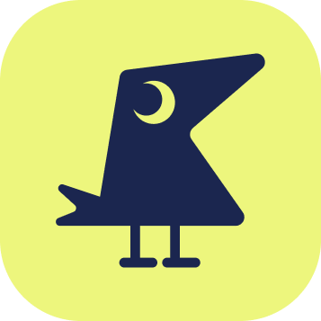
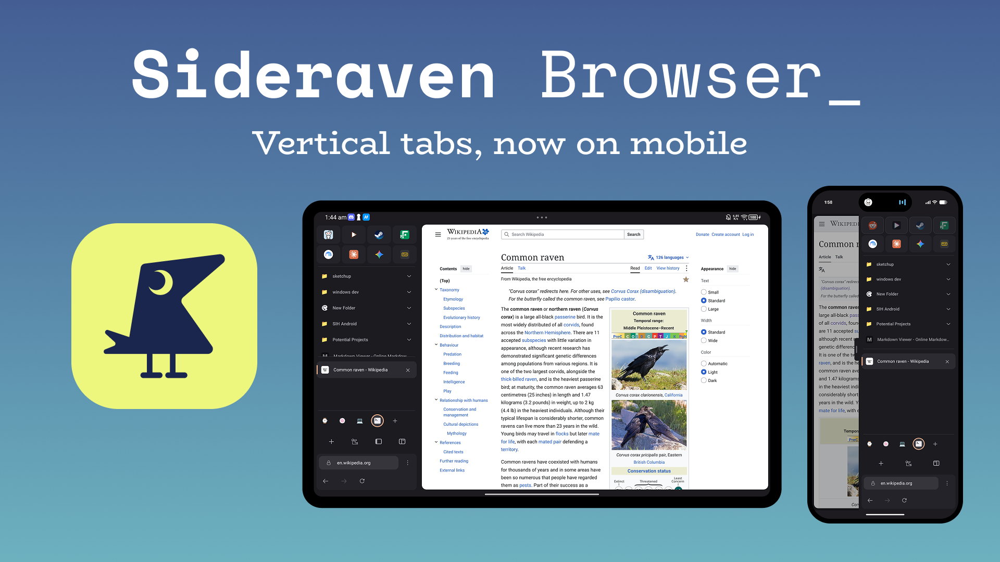
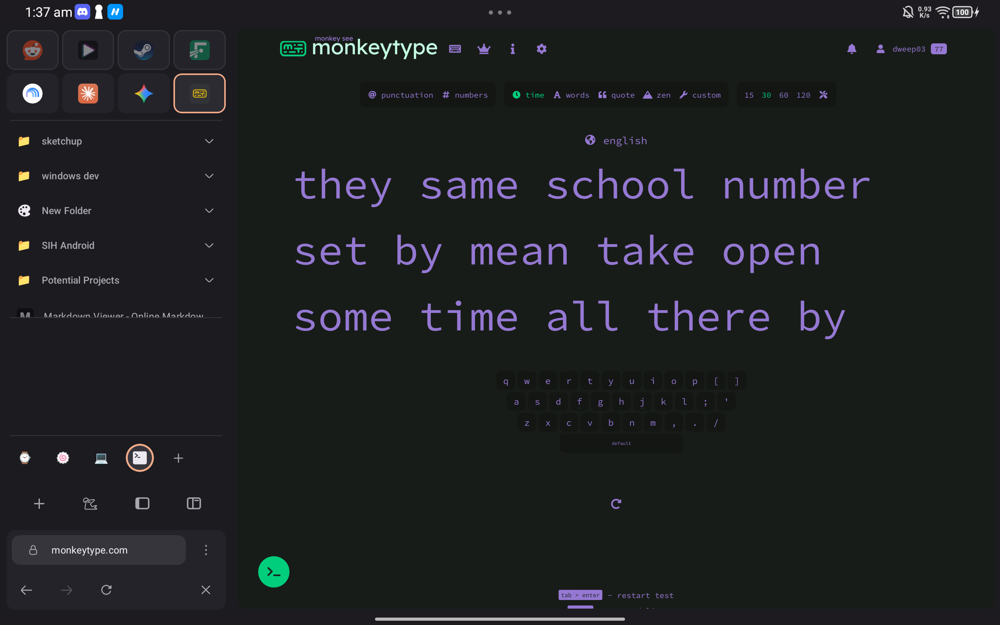
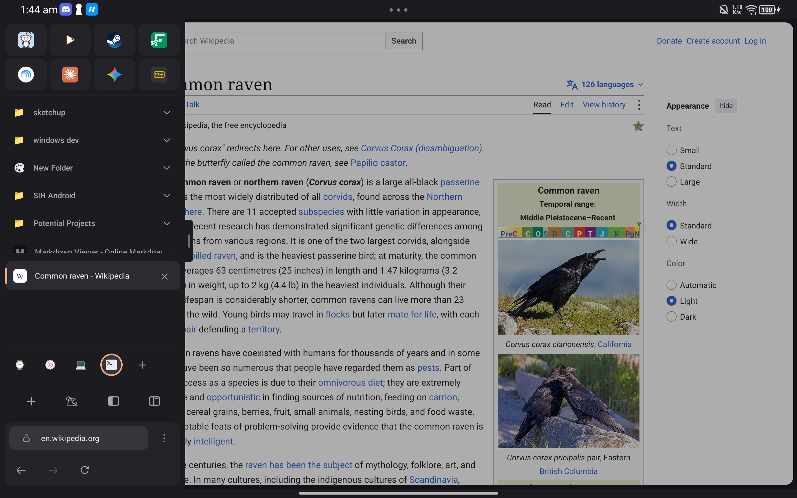
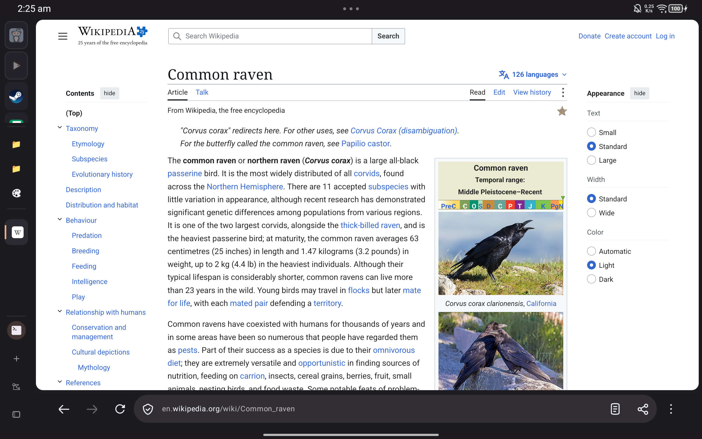
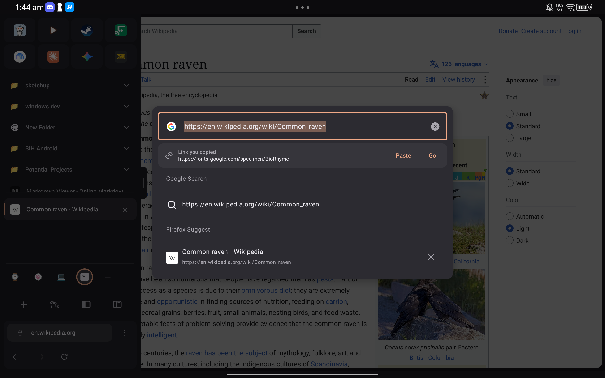
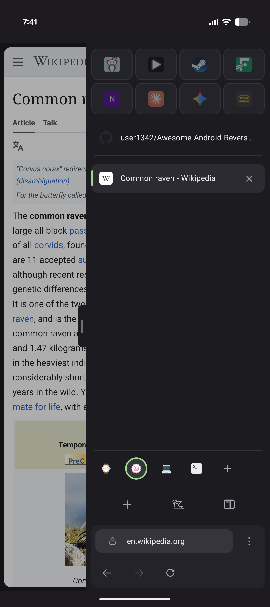
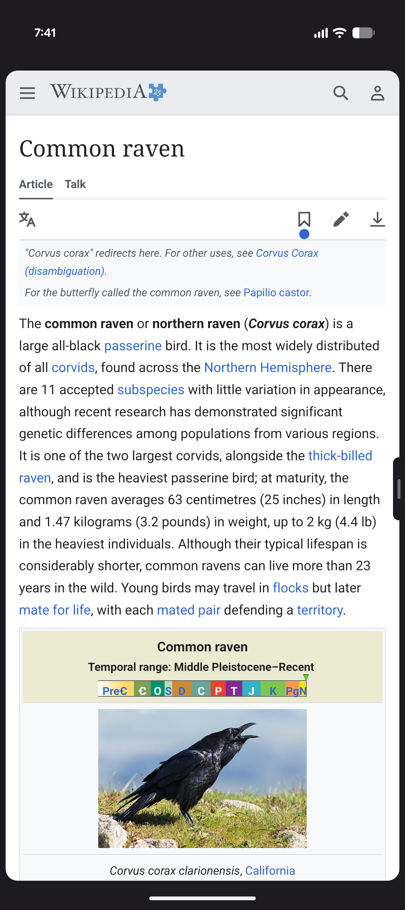

<div align="center">



# Sideraven

### Zen-style vertical tabs for Firefox on Android tablets, and phones too

[](https://github.com/Dweep4269/sideraven/releases/latest)
[](https://github.com/Dweep4269/sideraven/releases)
[](#install)
[](LICENSE)

[](https://github.com/Dweep4269/sideraven/issues/new?template=bug_report.yml)
[](https://github.com/Dweep4269/sideraven/issues/new?template=feature_request.yml)

[Screenshots](#screenshots) · [For Zen users](#for-zen-users) · [On your phone](#on-your-phone) · [Features](#features) · [Download](#download) · [FAQ](#faq) · [Build](#build-from-source) · [Support](#support-sideraven)



</div>

Sideraven is a web browser made mainly for Android tablets, and (not so much) for phones. Most Android browsers are built for phones first and stretched onto tablets. Sideraven starts from the tablet. Your tabs move off the top of the screen into a column down the side, the way [Zen Browser](https://zen-browser.app) does it on the desktop. Essentials sit at the top of the Sidebar, your pinned tabs below them, and Spaces keep work, study and everything else apart. If you use Zen on your computer, Sideraven can sync your Spaces, Essentials and pinned tabs with it.

Under the hood it's a fork of [Iceraven](https://github.com/fork-maintainers/iceraven-browser), which is a fork of Firefox for Android, so it keeps Firefox's engine, add-ons and sync.

> [!WARNING]
> Sideraven is an early, independent project. Mozilla, Zen and the Iceraven maintainers don't make, endorse or review it. Expect bugs, and keep a backup of anything you can't lose. Sideraven has a backup feature for exactly that.

> [!NOTE]
> Sideraven is built with substantial help from AI coding tools. Every change is tested and reviewed before it ships.

---

## Screenshots

<table>
  <tr>
    <td width="50%"></td>
    <td width="50%"></td>
  </tr>
  <tr>
    <td align="center"><b>Persistent:</b> the whole Sidebar beside the page</td>
    <td align="center"><b>Auto-Hide:</b> full-screen pages, the Sidebar a swipe away</td>
  </tr>
  <tr>
    <td width="50%"></td>
    <td width="50%"></td>
  </tr>
  <tr>
    <td align="center"><b>Collapsed:</b> just the icons, more room for the page</td>
    <td align="center"><b>Search pop-up:</b> suggestions, engines, your copied link</td>
  </tr>
</table>

---

## For Zen users

Sideraven organises tabs the way Zen does, and if you use Zen on your computer, it keeps the two in step.

### Zen's way of organising tabs

- **Spaces.** Separate sets of tabs for work, study or anything else, each with a name, an icon and a colour. Pick the icon from Zen's own icon set or any emoji. Switch with a tap, or with `Ctrl+Alt+←` and `Ctrl+Alt+→`.
- **Essentials.** Up to 12 sites as icons at the top of the Sidebar, the same in every Space. `Ctrl+1` to `Ctrl+9` open the first nine.
- **Pinned tabs and folders.** Up to 12 sites per Space that stay put, grouped into folders if you like. Unload one to free memory and it reopens where you left it.
- **Zen's look.** Rounded tabs, Zen's muted colours and an accent colour of your choice.

### Zen Sync

Zen Sync keeps your Spaces, Essentials, pinned tabs and folders the same on Sideraven and on Zen, in both directions. It goes through the Firefox account you already use, so there's nothing extra to install or host.

- **Your first sync, your call.** Keep this device's Spaces separate, replace them with your computer's, or merge both. Merging shows what it will add to Zen before anything is uploaded.
- **Pick your Spaces.** Choose which of your computer's Spaces appear here. New ones you make on the computer wait until you turn them on.
- **Keep some Spaces local.** Mark a Space **Don't sync this space** and it stays on this device only.
- **Pick what syncs.** Spaces with their pinned tabs and folders, Essentials, and Space colours each have their own switch.
- **See your desktop tabs.** The tabs open in a Space on your computer show at the end of that Space as **On desktop**. Tap one to open it here. Nothing changes on the computer.
- **Syncs by itself.** When the app opens, every 5 minutes while it's open, and after you change something. Or turn that off and tap **Sync now**.

To set it up:

1. In Zen on your computer, sign in to your Firefox account and turn on Spaces syncing. If Zen doesn't show the option, set `services.sync.engine.spaces` to `true` in `about:config`.
2. In Sideraven, sign in to the same Firefox account from the top of **Settings**.
3. Turn on Zen Sync in **Settings > Sideraven > Zen Sync** and choose how the first sync goes.

To see desktop tabs, also set `zen.spaces-sync.normal-tabs` to `true` in Zen's `about:config`.

> [!NOTE]
> Zen Sync is Sideraven's own feature, not an official Zen one. If Zen changes how it stores Spaces, Sideraven stops writing to them until it catches up. It keeps reading, so nothing is lost.

---

## On your phone

<p align="center">
  
  
</p>

On a phone the Sidebar stays out of the way until you want it, so the page gets the whole screen.

- **A handle at the edge.** Tap it or pull it to open the Sidebar. Hold it and slide it up or down to where your thumb rests.
- **Full-screen pages.** Move the address bar into the Sidebar and Firefox's toolbar goes away. Back, forward and reload come with it.
- **Your back gesture still works.** Swiping in from the edge to open the Sidebar is off on phones. Turn it on in **Settings > Sideraven > Sidebar** if you'd rather swipe than tap.
- **Split screen and foldables.** Sideraven picks its layout from the size of its window, so it changes when you resize it or unfold the phone.
- **Nothing left behind.** Spaces, Essentials, pinned tabs, the search pop-up and swipe-to-close all work the same as on a tablet.

Prefer Firefox's own tab tray on your phone? Turn off **Use the sidebar on phones** in **Settings > Sideraven > Sidebar**.

---

## Features

<table>
<tr>
<td width="50%" valign="top">

#### The Sidebar
- **Persistent** keeps the full Sidebar beside the page.
- **Collapsed** shrinks it to a strip of icons.
- **Auto-Hide** keeps it out of the way until you pull it from the screen edge or tap its handle. Hold the handle to move it up or down.
- Put it on the left or the right.
- `Ctrl+Shift+S` switches between the modes.

</td>
<td width="50%" valign="top">

#### Tabs
- Swipe a tab toward the screen edge to close it.
- Drag tabs to reorder them, or onto Essentials to pin them.
- Unload tabs you aren't using to free memory. They reload when you open them.
- Private browsing switches instantly and gets its own Sidebar.

</td>
</tr>
<tr>
<td width="50%" valign="top">

#### Search and the address bar
- A pop-up search bar with suggestions, search engines, your copied link, QR scanning and voice search.
- Move the address bar into the Sidebar for a full-screen page, in any mode that can show it.

</td>
<td width="50%" valign="top">

#### Make it yours
- Row size, accent colour, animations and haptics.
- App icons, including a few made just for Sideraven.
- **Backup:** save your Spaces, Essentials, pinned tabs and settings to a file, and restore them on another device.

</td>
</tr>
<tr>
<td colspan="2" valign="top">

#### Everything from Iceraven
- Firefox's GeckoView engine, Firefox Sync and tracking protection.
- A longer add-on list than Firefox's, and `about:config`.
- Iceraven's telemetry removal. Sideraven adds no analytics of its own.

</td>
</tr>
</table>

---

## Download

<p align="center">
  <a href="https://github.com/Dweep4269/sideraven/releases/latest"></a>
  <a href="https://apps.obtainium.imranr.dev/redirect?r=obtainium://add/https://github.com/Dweep4269/sideraven"></a>
</p>

| Where | Status |
|---|---|
| GitHub Releases | [](https://github.com/Dweep4269/sideraven/releases/latest) |
| Obtainium | Tracks GitHub Releases: add `https://github.com/Dweep4269/sideraven` |
| IzzyOnDroid | Planned, once 1.0 settles |
| Google Play | Not planned |

### Install

Sideraven runs on Android 8.0 or newer.

1. Download `sideraven-<version>-arm64-v8a.apk` from the [latest release](https://github.com/Dweep4269/sideraven/releases/latest). If your device is an older 32-bit one, take `armeabi-v7a` instead.
2. Open the file. When Android asks, let your browser or file manager install apps.

With Obtainium, tap the badge above, or tap **Add app** and enter `https://github.com/Dweep4269/sideraven`. Obtainium then tells you when an update is out.

Sideraven installs as `app.sideraven.browser`, a separate app from Firefox and Iceraven, so you can keep them side by side. Updates install over each other without losing your data.

### Verify your download

Every release is signed with Sideraven's own key. Its certificate's SHA-256 fingerprint is:

```
8F:D7:0E:28:D8:B8:14:80:D5:AA:D6:E6:95:C6:E0:96:2B:35:33:A1:34:56:62:17:E7:AE:E9:7A:B1:B7:A9:6C
```

Check it with `apksigner verify --print-certs sideraven-<version>-arm64-v8a.apk`, or with [AppVerifier](https://github.com/soupslurpr/AppVerifier) on the phone.

---

## FAQ

<details>
<summary><b>Does it work on phones?</b></summary>

Yes. The Sidebar waits at the edge of the screen behind a handle, and pages can fill the whole screen. See [On your phone](#on-your-phone). To use Sideraven with Firefox's tab tray instead, turn off **Use the sidebar on phones** in **Settings > Sideraven > Sidebar**.
</details>

<details>
<summary><b>Do I need Zen?</b></summary>

No. Spaces, Essentials and pinned tabs work on their own. Zen Sync is only for people who also use Zen on a computer.
</details>

<details>
<summary><b>Can I keep using Firefox or Iceraven?</b></summary>

Yes. Sideraven is a separate app with its own data, so all three install side by side. Sign in to the same Firefox account to share bookmarks, history and passwords.
</details>

<details>
<summary><b>Do my add-ons work?</b></summary>

The add-ons that work in Iceraven work in Sideraven. Iceraven offers a longer list than Firefox, but not every add-on works on Android.
</details>

<details>
<summary><b>Why isn't it on Google Play?</b></summary>

Sideraven is a small, independent project, and GitHub Releases with Obtainium covers updates. An IzzyOnDroid listing is planned once 1.0 settles.
</details>

<details>
<summary><b>Does it send data anywhere?</b></summary>

Sideraven keeps Iceraven's removal of Firefox's data collection and adds no analytics of its own. Firefox Sync and Zen Sync talk to Mozilla's sync servers only when you sign in and turn them on.
</details>

---

## Planned

These aren't in Sideraven yet:

- A Sidebar button for the synchronised tabs feature by firefox
- Settings to hide Sidebar buttons you don't use, for a cleaner Sidebar
- Split view, with two tabs side by side
- Searching your tabs from the Sidebar, and selecting several tabs at once
- Folders for ordinary tabs
- Zen theming (a simpler version of it)

---

## Build from source

<details>
<summary>Build Sideraven yourself</summary>

You need Linux (or WSL on Windows), JDK 17 and the Android SDK. The first build compiles Firefox's Android code, so it takes about an hour and 8 GB of memory.

```sh
git clone --recursive https://github.com/Dweep4269/sideraven
cd sideraven
./automation/iceraven/install-sdk.sh          # the Android SDK and NDK, in ~/android-sdk
./automation/sideraven/prepare.sh --release   # Iceraven's patches; the app's text says Sideraven
./gradlew app:assembleForkRelease -PversionName=1.0.0
```

The APKs land in `gradle/build/app/outputs/apk/forkRelease/`, unsigned. Android only installs a signed APK, so sign the one for your device with a key of your own:

```sh
keytool -genkeypair -keystore my-key.jks -alias me -keyalg RSA -keysize 4096 -validity 10000
apksigner=$(ls -d ~/android-sdk/android-sdk-linux/build-tools/*/apksigner | sort -V | tail -1)
"$apksigner" sign --ks my-key.jks --out sideraven.apk \
  gradle/build/app/outputs/apk/forkRelease/app-arm64-v8a-forkRelease-unsigned.apk
```

A build signed with your key can't update an official release, or the other way round. Uninstall one before installing the other.

To work on Sideraven itself, build the development app, Sideraven Dev, with `./gradlew app:assembleForkDebug`. It installs beside the release. Run Sideraven's tests with:

```sh
./gradlew -PtestBuildType=forkDebug -PsideravenTests app:testForkDebugUnitTest
```

Sideraven's own code lives in `app/src/main/java/pt/dweep/sideraven/`. Where it has to change Iceraven's files, the change is a short call marked `SIDERAVEN-HOOK`, so updating to a new Firefox version stays manageable. `./automation/sideraven/list-hooks.sh` lists them all.
</details>

---

## Get help

- Found a bug? [Report it](https://github.com/Dweep4269/sideraven/issues/new?template=bug_report.yml), with your Sideraven version and Sidebar mode.
- Have an idea? [Request a feature](https://github.com/Dweep4269/sideraven/issues/new?template=feature_request.yml).
- Contributions are welcome. For anything big, open an issue first so we can agree on the approach.

---

## Support Sideraven

Sideraven is free. If it's become your everyday browser and you'd like to say thanks, you can send a small donation by UPI. It helps me keep up with new Firefox versions and keep building features.

<p align="center">
  
</p>
<p align="center">Scan the code with any UPI app, or pay to <code>s12142647-1@okhdfcbank</code>.</p>

---

## Credits

Sideraven builds on Mozilla's Firefox for Android, GeckoView and Android Components, and on the Iceraven fork. The Sidebar, Spaces and Essentials follow ideas from Zen Browser. The wordmark uses Space Mono by Colophon Foundry, under the SIL Open Font License. The A Short Hike app icon is a fan tribute to the game by adamgryu.

## Star history

<a href="https://star-history.com/#Dweep4269/sideraven&Date">
  
</a>

---

<p align="center">
  <sub>Sideraven is licensed under the <a href="LICENSE">Mozilla Public License 2.0</a>. It isn't affiliated with Mozilla, Zen, Iceraven or the makers of A Short Hike. Firefox is a trademark of the Mozilla Foundation, and Sideraven uses no Mozilla or Zen logos.</sub>
</p>
